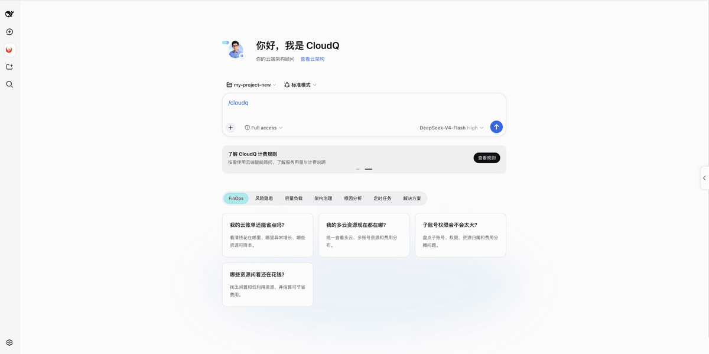
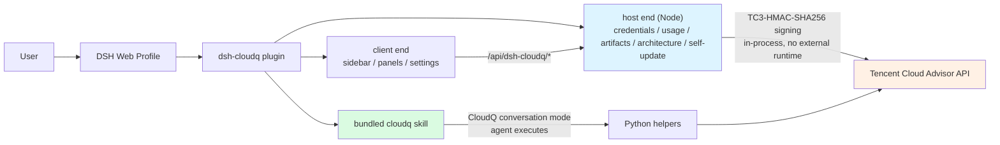

# dsh-cloudq

[](https://www.npmjs.com/package/dsh-cloudq)
[](https://www.npmjs.com/package/dsh-cloudq)
[](https://www.npmjs.com/package/dsh-cloudq)
[](LICENSE)

English | [简体中文](README-zh.md)

CloudQ integration for [DeepSeek Harness](https://github.com/deepseek-ai/deepseek-harness). It adds a CloudQ mode to the Web profile, bundles the `cloudq` skill, and provides CloudQ usage and architecture views, local credential setup, and plugin management.

## Features

- **CloudQ conversations**: ask cloud operations questions through the bundled skill using the native DSH composer.
- **Welcome suggestions**: browse categorized prompts and fill your draft with a click; configure credentials from the welcome page or plugin settings.
- **Plans and usage**: view subscription quotas, active credit packs and paginated usage details, with links to official purchase pages.
- **Artifacts**: browse and download conversation artifacts; the list refreshes silently after CloudQ replies complete.
- **Read-only architecture viewer**: explore saved diagrams in-page with 2D/3D, zoom, fit and fullscreen controls, or open them in Cloud Advisor.
- **Integrated workspace**: light/dark themes, a collapsible side panel, plugin management and update notifications.

For version history, see the [changelog](CHANGELOG.md).

## Demo



Explore categorized suggestions, plans and usage, artifacts, and the read-only architecture viewer.

## Requirements

- Node.js `>=22.19.0`
- DeepSeek Harness `0.1.1-rc.2` or a compatible newer `0.1.x` release
- `pnpm` available to the `dsh plugin` command
- macOS, Linux, or Windows
- The conversation mode requires Python 3 available as `python3`. Credential setup, welcome suggestions, plans and usage, artifacts, and the architecture viewer do not require Python.
- The architecture viewer requires WebGPU or WebGL2. The bundled Tessera runtime prefers WebGPU and falls back to WebGL2; if neither is available, use the Cloud Advisor link.

## Install

```sh
dsh plugin --profile web add dsh-cloudq
```

Restart the Web profile after installation:

```sh
dsh --profile web
```

Open the URL printed by DSH. The conversation input area and sidebar will expose the CloudQ entry. You can also invoke the bundled skill explicitly with `/cloudq`.

## Upgrade and remove

```sh
dsh plugin --profile web update dsh-cloudq
dsh plugin --profile web remove dsh-cloudq
```

Restart the Web profile after changing the installed package set.

## Usage

1. Open **Settings → Plugins** and expand the **CloudQ** card.
2. Enter your Tencent Cloud `SecretId` and `SecretKey` (available from the [CAM console](https://console.cloud.tencent.com/cam/capi)).
3. Click **测试连接** to validate the pair, then **保存配置**. The card shows **AKSK有效** once the credential is active.
4. Open a CloudQ conversation from the sidebar, or explicitly invoke `/cloudq`. On the welcome page, unconfigured users can also click **配置 AK/SK** and complete setup in the quick dialog.
5. Choose a suggestion category and click a card to fill the draft; review it and send with the native DSH composer.
6. Use the handle at the right edge to open **Usage / Artifacts / Architecture**. Usage shows plans and credits; architecture cards open an in-page read-only viewer with 2D/3D, fit, zoom and fullscreen controls. **在云顾问查看** opens the corresponding console page.

## How it works



## Credentials

The settings card accepts a Tencent Cloud `SecretId`/`SecretKey` pair.

- Credentials are stored in plaintext at `~/.tencent-cloudq/credential.json`, not in an encrypted vault. Unix uses directory mode 700 and file mode 600; Windows access control depends on the user directory ACL. Protect the local OS account.
- Panel APIs sign and call Tencent Cloud in-process (native Node implementation); secrets never pass through any subprocess or appear in process lists.
- Browser APIs return only credential state and masked identifiers; local credential paths and secret values are not returned.
- Use the logout action to remove the stored credential.

Follow least-privilege: grant only the permissions required for the CloudQ operations you intend to run. The bundled skill can invoke read and write cloud-management operations; review each action before approving it.

## Security model

- Host APIs accept only loopback, same-origin requests.
- JSON request bodies are limited to 64 KiB.
- Unexpected internal errors are not returned to the browser.
- Remote values are inserted with DOM text nodes rather than HTML injection.
- Download links require HTTPS.
- No credentials, tokens, or local environment files are included in the npm package.

Report security issues through [GitHub Issues](https://github.com/TencentCloud/cloudq-for-dsh/issues) without including live credentials.

## FAQ

**Can't install or update to the latest version?**

Check the version status on npm first: **Validating** means automated review is pending and the version is not publicly available yet. Pinning a version cannot bypass this review.

For a published version, pnpm 11's default 24-hour release-age policy may delay installation. Wait for the cooldown, or explicitly select a reviewed version with `dsh-cloudq@<version>`, subject to your local security policy.

**Does it work on Windows? Do I need Python?**

Yes. The settings, usage, inspiration, artifact, and architecture panels are a native Node implementation and need **no Python** on any of macOS / Linux / Windows. Only **CloudQ conversation mode** is driven by the bundled skill and requires `python3`.

**Where is my AK/SK stored? Is it safe?**

At `~/.tencent-cloudq/credential.json`. See [Credentials](#credentials) for storage and permission details. The **退出登录** action removes the local credential.

**Why does 测试连接 fail?**

Check that the local DSH service is running and can reach Tencent Cloud, then check the returned error for key validity, permissions and CloudQ activation. Connection testing does not require Python.

## Development

```sh
pnpm install
pnpm run lint
pnpm run typecheck
pnpm run test:all
pnpm run build
pnpm run check:client
npm pack --dry-run --registry=https://registry.npmjs.org/
```

The npm package ships prebuilt Host and Web client artifacts, the bundle patch, the runtime logo, and the bundled skill. Registry installation runs no build scripts.

## Repository layout

```text
src/                         Host and Web client source
skills/cloudq/               Bundled CloudQ skill and Python helpers
assets/cloudq.png            Runtime logo served by the Host
scripts/                     Build and release checks
tests/                       Unit, integration, and package-contract tests
cordis.patch.yml             DSH bundle layer
```

## Release

Source is reviewed and versioned in [TencentCloud/cloudq-for-dsh](https://github.com/TencentCloud/cloudq-for-dsh). An npm version is published to the official registry only after the repository checks and the package-install smoke test pass.

## More documentation

- Changelog: [`CHANGELOG.md`](CHANGELOG.md)
- Development & maintenance guide: [`DEVELOPMENT.md`](DEVELOPMENT.md)

## License

The plugin is licensed under MIT. See [`LICENSE`](LICENSE). The bundled Tessera runtime and its third-party dependencies have separate notices and license texts in [`assets/tessera/NOTICE`](assets/tessera/NOTICE).
